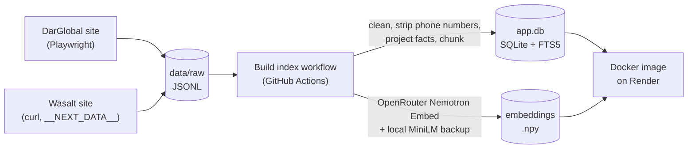
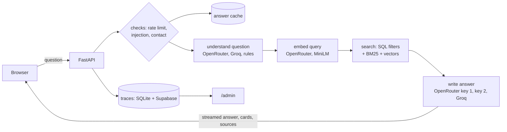

# DarGlobal / Wasalt property assistant

A chatbot that answers questions about DarGlobal's projects and Wasalt's Saudi property listings, using data
scraped from their public websites. Answers come from a free OpenRouter model, and the whole thing runs as one
Docker container.

Built for the Junior AI Engineer technical assignment. Not affiliated with DarGlobal or Wasalt.

Live: https://darglobal-property-assistant-hzvz.onrender.com
(free Render instance, so the first request after it has been idle can take about 50 seconds)

Admin dashboard at `/admin` (needs the admin token), API docs at `/api/docs`.

## What you can ask

- Listing searches: "3-bed apartments for rent in Riyadh under 90k SAR". The question is turned into filters and
  run against the listings. If nothing matches, some filters are loosened and the answer says which ones.
- Questions about DarGlobal projects, brands, FAQs and so on, answered from the scraped pages with numbered
  citations that link back to the source.
- Market numbers: "median villa price in Jeddah". Sale prices and rents are kept separate.
- Comparisons: "compare Da Vinci Tower and Marea".
- Follow-up questions: after asking about a project, "and what's the payment plan?" works, because the last
  few messages are sent along and the question is rewritten into a standalone search.
- Arabic works as well as English.

Every answer has a thumbs up / down. The vote is stored with that chat's trace and shows up on `/admin`, both
as a satisfaction rate and in the list of recent conversations.

## How it works

Scraping and indexing happen offline. The result (a SQLite file and NumPy arrays of embeddings) is copied
into the Docker image, so the deployed app never calls the source sites.



When someone asks a question:



OpenRouter's free models are the primary providers, with Groq as a fallback:

| Job | Model | Fallback |
|---|---|---|
| Writing the answer | Nemotron 3 Ultra, then Gemma 4 31B | Groq gpt-oss-120b |
| Understanding the question | Nemotron 3.5 Lightning, then Gemma 4 26B A4B | Groq Qwen, then a keyword/regex parser |
| Embeddings | Nemotron 3.5 Embed 1B | local multilingual MiniLM (int8 ONNX) |

A free OpenRouter account allows about 50 requests a day across all models, so the app can use up to three
OpenRouter keys (`OPENROUTER_API_KEY`, `_2`, `_3`): keys 1 and 2 write answers, key 3 handles embeddings and
question understanding. Each key has its own daily cap, and when one runs out the next is used. Groq only
comes in once the OpenRouter keys are used up, so the app keeps working instead of failing.

At runtime, a request goes through:

1. Basic checks: rate limit per IP, message length, an obvious prompt-injection filter, and a fixed reply if
   someone asks for an owner's or agent's phone number (DarGlobal questions get DarGlobal's official sales line).
2. A cache of previous answers (exact match on the question, or a very close embedding).
3. The router works out the intent and filters as JSON.
4. Retrieval. The question is embedded with the OpenRouter model (or the local one if that's unavailable; each
   has its own index, since vectors from different models can't be compared). Listings are filtered in SQL and
   then reranked. Page text uses BM25 (SQLite FTS5) and vector search, combined with reciprocal rank fusion.
5. The answer is streamed back over SSE. If no model is available at all, the user still gets the matching
   listings and source snippets without a written answer.

Each model has a per-minute limit, a daily cap kept under the free-tier quota, and a circuit breaker that backs
off on 429s and auth errors. It only switches models before the first token has been sent, so one answer is
never stitched together from two models.

Some choices worth explaining:

- No vector database. There are about 2,700 vectors, and a brute-force NumPy search over them takes a few
  milliseconds.
- The local backup embedder. With the normal Hugging Face tokenizer and the fp32 model, the app used about
  650 MB, which doesn't fit Render's 512 MB free tier. The tokenizer alone was around 260 MB. I quantized the
  model to int8 ONNX at build time and wrote a small Unigram tokenizer for it (`app/rag/embedder.py`). It now
  runs in about 275 MB, and retrieval scores didn't change.
- Bad data. 46 Wasalt rentals were marked as yearly but priced under 8k SAR, so they're almost certainly
  monthly. They're kept but marked as unclear and left out of the price statistics.

## Data

- DarGlobal (darglobal.co.uk): 42 project pages plus company, FAQ, insight, blog and press pages. The site
  renders in the browser, so it's scraped with Playwright, slowly. Project facts (city, bedrooms, brand,
  payment plan...) are pulled out with an LLM once and cached.
- Wasalt (wasalt.sa): about 1,100 sale and rent listings taken from the sitemap. Each listing page has its data
  as JSON in `__NEXT_DATA__`, which is easier to rely on than the HTML.

Both scrapers read the site's robots.txt and skip any URL it disallows (Wasalt's llms.txt was reviewed by
hand), make about one request a second, and don't store owner or agent names or phone numbers. Some owners type their mobile number into the listing description, so
phone numbers and e-mail addresses are stripped from the text as well, and the build fails if any are left. Counts and scrape dates are in `data/manifest.json`.

## Evaluation

```bash
python -m evals.run                # retrieval + rule router, no API calls (this is what CI runs)
python -m evals.run --llm-router   # also the LLM router
python -m evals.run --answers      # full answers, graded by an LLM judge
```

Latest run: retrieval hit@5 100%, router intent accuracy 100% with the LLM vs 90% with the rule parser, and
7/7 answers judged correct and faithful (including the ones that should refuse). It's a small test set,
so take these numbers as a sanity check. Full results are in `evals/report.md` and on the admin page.

## Logging

Every chat turn is logged (question, answer, intent, filters, model used, retrieved items, timings, feedback)
to local SQLite and also to Supabase, so the history survives restarts. API calls and daily model usage go
to Supabase too. The Supabase writes run in a background queue, and if Supabase is down the app keeps working
on SQLite only. IPs are stored as hashes. The table definitions are in `deploy/supabase_schema.sql`.

## Running it

```bash
python -m venv .venv && .venv/Scripts/activate     # source .venv/bin/activate on Linux/macOS
pip install -r requirements-dev.txt
cp .env.example .env                                # add your OpenRouter and Groq keys and an admin token
uvicorn app.main:app --port 7860
```

With Docker:

```bash
docker build -t property-assistant .
docker run -p 7860:7860 --env-file .env property-assistant
```

The index is built by the "Build index" GitHub Actions workflow (Actions tab, Run workflow). It rebuilds
`data/app.db` and the embeddings from the scraped data in `data/raw`, runs the tests and evals, and commits the
result, which triggers a Render deploy. It needs the OpenRouter and Groq keys as repository secrets.

To scrape again and rebuild locally instead (takes roughly 45 minutes):

```bash
python -m playwright install chromium
python -m scrapers.darglobal && python -m scrapers.wasalt --n 1200
python -m pipeline.build --enrich --remote-embed   # --remote-embed fetches OpenRouter embeddings (about 43 requests, cached)
```

Tests: `pytest -q`

## Configuration

Settings live in `config/settings.yaml` (models, limits, retrieval parameters), prompts and fixed replies in
`config/prompts.yaml`, and lookup data like currency rates and city names in `config/reference.yaml`. API keys
only come from the environment or `.env`.

Any setting can be overridden with an environment variable, using `__` between levels, for example
`LLM__GENERATION__MAX_TOKENS=900`.

## Layout

```
scrapers/   darglobal.py, wasalt.py, common.py
pipeline/   build.py (clean, chunk, embed, index), schemas.py
app/        main.py (FastAPI), config.py, resources.py, db.py, storage.py, telemetry.py
  llm/      gateway.py (model failover and limits), cache.py
  rag/      router.py, store.py (retrieval), chat.py, prompts.py, embedder.py
  static/   chat UI and admin page
config/     settings.yaml, prompts.yaml, reference.yaml
evals/      golden.jsonl, run.py, report.md
tests/
```

## Limitations

- The Wasalt data is a sample of about 1,100 listings out of roughly 60,000, from a single scrape. It would need a
  scheduled refresh to stay current.
- DarGlobal rarely publishes prices, so for most projects the assistant can only say the price is on request.
- If I had more time: a reranker model, Postgres with pgvector once the data grows, and better handling of long
  conversations.
